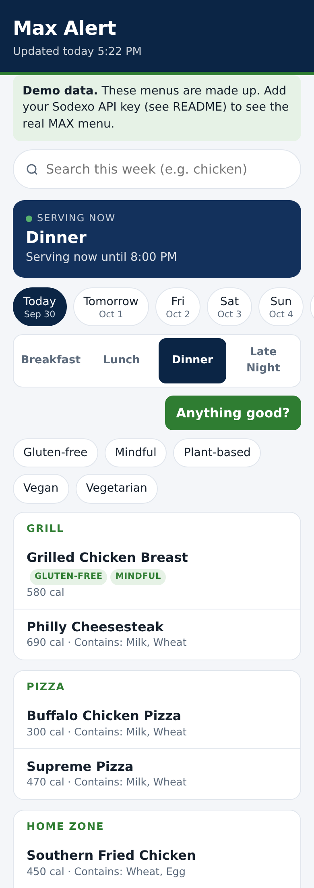

# Max Alert

A mobile-first web app that shows what the GCSU dining hall (The MAX) is serving: now, later today, and all week.



**Features:** current/next meal on the home screen, date picker + meal tabs, location filter (it appears automatically when there's more than one location), dietary badges and filters, week-wide search, and an "Anything good?" button that gets a casual AI summary of today's menu.

**Follows the clock:** the page opens on the meal being served now and switches by itself when the next meal starts, even in a tab left open all day. If you pick a different meal, it goes back to following the clock at the next meal change. When The MAX is closed, the top card says **"The MAX is closed · Opens at …"** with the next meal underneath.

**Menu layout:** stations are collapsible sections labeled like "Main Grill Area (8)". They start collapsed except the one you opened last, and there's **Expand all / Collapse all**. Some of Sodexo's station names are swapped for clearer ones (Bliss → Dessert, Grown → Vegetarian, Showcase → Main Grill Area, Stacked → Sandwich Area, Mix → Salad). Savory, Main Grill Area, Simply 3 and Slices come first; Vegetarian and Dessert come last. Both the names and the order are set in `STATION_NAMES`, `STATIONS_FIRST` and `STATIONS_LAST` in `config.py`. The **Proteins** button lists protein-focused dishes (chicken, beef, fish, eggs, tofu...) from every station, highest protein first.

**Thumbs up/down:** every dish has 👍/👎 with vote counts, plus "% liked" once it has 3 votes. Ratings belong to the dish name, so a dish keeps its rating when it comes back. Each person gets one vote per dish (per account, or per browser when logged out), and only dishes on this week's menu can be rated.

**Hours tab:** live open/closed status, today's hours and the full week for The MAX, Chick-fil-A, Einstein Bros., Ibasho Sushi, Books & Brew, Pizza Hut and The Mini. The hours come from the GCSU Dining hours page, break and holiday hours included.

**Favorite dish alerts:** tap ☆ on any dish to star it (needs an account). On mornings when a starred dish is on the menu, you get one push notification around 7 AM listing it and the meals it's at, e.g. "Chicken Tenders is on the menu today · At The MAX: Lunch 11:00 AM – 2:00 PM". Notifications come through the free **ntfy** app. Each account gets its own private topic, shown in **Settings → Favorite dish alerts** with setup steps and a **Send a test notification** button. The same card lists your favorites with when each one is served next.

**Add to Home Screen:** the site installs like an app (its own icon, opens full screen). Android/Chrome shows an **Install** button; on iPhone, Safari shows the Share → Add to Home Screen steps. A service worker (`static/sw.js`) keeps the last menu, hours and ratings on the phone. With bad or no signal, the app opens with that saved menu and a "No connection" note instead of an error. Logins, calorie logs and favorites are never saved on the phone.

**Accounts + Build Your Plate:** the menu never needs a login. Tap **+** on any dish to add it to My Plate (a bottom sheet), adjust servings in half steps, and see running calories/protein/carbs/fat. **Log this meal** saves to your account; if you're logged out it asks you to log in or sign up first. **Forgot password?** on the log-in screen emails a reset link (see "Turn on password reset emails"). The log-in and sign-up forms work with password managers: iPhone Keychain offers saved logins and suggests a strong password when signing up, and Android/Chrome offers to save it. From the profile icon (top right): **My Calories** (today's meals, totals, goal progress, edit/delete), **Settings** (calorie goal) and **Log out**. **Quick add** covers anything not on the menu.

**Stack:** Python Flask backend (fetches + caches the menus) and a plain HTML/CSS/JS frontend (no build step).

---

## Run it locally

You need Python 3.10+.

```bash
cd max-alert
python -m venv .venv
source .venv/bin/activate          # Windows: .venv\Scripts\activate
pip install -r requirements.txt
python app.py
```

Open http://localhost:5000. To try it from your phone, open `http://<your-computer's-IP>:5000` while on the same Wi-Fi.

With no keys set, the app runs in **demo mode**: it shows made-up sample menus and a "Demo data" banner. That lets you see the UI right away.

### Hook up the real GCSU menu (one time)

```bash
pip install playwright && playwright install chromium   # optional but most reliable
python discover.py
```

`discover.py` opens The MAX's page, finds the menu API call, and writes:

- `locations.json`: each location's Sodexo `location_id` and `menu_id`
- `.env`: `SODEXO_API_KEY=...`

Restart `python app.py`. The banner goes away and the real menu loads.

If the script can't find everything, do it by hand (takes about 2 minutes; see "How the data source works" below). Copy `locations.example.json` to `locations.json` and `.env.example` to `.env`, then fill them in.

### Turn on "Anything good?"

Get an API key at https://console.anthropic.com and add it to `.env`:

```
ANTHROPIC_API_KEY=sk-ant-...
ANTHROPIC_MODEL=claude-haiku-4-5
```

Only today's menu is sent, and results are cached, so repeat taps don't cost anything. Without a key, the button shows a friendly "not set up yet" message. When you create the key in the Anthropic Console, pick **"Somewhere else" (API key)**. The keyless sign-in options don't work with this app. `ANTHROPIC_MODEL` is optional.

If the button shows an error: `401` means the key is wrong, `400`/`404` means the model name is wrong, and "Couldn't reach the AI" is a network problem.

### Turn on favorite dish alerts

Starring and the Settings card work with no setup. To have the alerts actually go out each morning on Render:

1. **Make a cron secret.** Run `python -c "import secrets; print(secrets.token_hex(24))"` and put the result in `.env` as `CRON_SECRET=...`.
2. **Render:** add `CRON_SECRET` (same value) in your service's **Environment** tab.
3. **GitHub:** in the repo, go to **Settings → Secrets and variables → Actions** and add two repository secrets:
   - `MAX_ALERT_URL`: your site's address, e.g. `https://max-alert.onrender.com`
   - `CRON_SECRET`: the same value again
4. Test it: **Actions → Daily favorite alerts → Run workflow**. The log should end in `HTTP 200` (or `"skipped": "too early"` before 7 AM).

Why the GitHub Action: Render's free plan puts the app to sleep after about 15 minutes with no visitors, so a timer inside the app wouldn't fire. The workflow (`.github/workflows/daily-alerts.yml`) wakes it at 7:15 AM campus time, waits while it downloads today's menu, and calls `POST /api/cron/daily`. As a backup, the first page visit after 7 AM runs the same check. Each person gets at most one alert a day no matter how many times it runs. GitHub sometimes starts scheduled runs late (up to an hour at busy times). If that matters, a free service like cron-job.org can call the same URL with the header `Authorization: Bearer <CRON_SECRET>`.

### Get alerted if menus stop updating (recommended)

The app repairs itself when Sodexo rotates its key or starts a new menu (see "If it breaks"). If it can't, it can ping you. Easiest option, free push notifications with no account:

1. Install the **ntfy** app (iOS/Android) and subscribe to a long random topic name, e.g. `max-alert-7f3k29xq`.
2. Add to `.env` (and to your host's environment variables):

```
ALERT_WEBHOOK_URL=https://ntfy.sh/max-alert-7f3k29xq
```

You get a message after 12 hours of failed downloads (`ALERT_AFTER_HOURS`), a reminder each day it lasts, one when it fixed itself, and one when menus are back. Discord and Slack webhook URLs work too. Without a URL, alerts only go to the server log.

### Run the tests

```bash
pip install pytest
python -m pytest -q
```

Tests never download the real menus or hours page.

---

### Turn on password reset emails

Emails go through **Brevo**. Its free plan allows 300 emails a day and doesn't need your own domain. Render's free plan blocks normal (SMTP) email, so the app uses Brevo's web API instead.

1. Sign up at [brevo.com](https://www.brevo.com) (free plan).
2. **Senders, Domains & Dedicated IPs → Senders → Add a sender:** use the address emails should come from (your own email is fine) and click the confirmation link Brevo sends you.
3. **SMTP & API → API keys → Generate a new API key.** Copy it (it starts with `xkeysib-`).
4. **Render → Environment:** add `BREVO_API_KEY` (the key) and `MAIL_FROM` (the sender address from step 2). Optionally add `MAIL_FROM_NAME` (default "Max Alert").
5. Test it: on the site, tap **Log in → Forgot password?** and enter your account email.

Locally, without these settings, the email is printed in the terminal running `python app.py` instead, so you can test the whole flow. On Render without them, **Forgot password?** says reset emails aren't set up (links are never written to Render's logs).

Emails sent from a Gmail or school address through Brevo can land in spam, since Gmail can't confirm Brevo is allowed to send for that address. If that happens a lot, adding your own domain in Brevo (and sending from it) fixes it.

**How resets work:** the link looks like `https://your-site/#reset=…`. It works for 1 hour and only once, and the part after `#` never reaches the server or its logs. Asking for a link gives the same answer whether or not the email has an account. Changing the password logs out every other device. Limits: 3 emails per address and 5 requests per IP per hour.

## Deploy on Render

`render.yaml` is a Render Blueprint for a free web service. It runs `gunicorn`, generates `SECRET_KEY` and sets `SECURE_COOKIES=1`. Render redeploys every time you push to GitHub.

**Secrets never go in git.** `.env` is in `.gitignore`. On Render, add each secret once under your service → **Environment**, and it carries over to every deploy:

| Variable | Needed for |
|---|---|
| `SODEXO_API_KEY` | Real menus (without it: demo mode) |
| `ANTHROPIC_API_KEY` | "Anything good?" button |
| `ALERT_WEBHOOK_URL` | Optional: alerts if menus stop updating |
| `CRON_SECRET` | Favorite dish alerts (see "Turn on favorite dish alerts") |
| `BREVO_API_KEY`, `MAIL_FROM` | Password reset emails (see "Turn on password reset emails") |
| `ANTHROPIC_MODEL`, `REFRESH_HOURS`, ... | Optional: see "Settings" below |

`locations.json` is committed, so the deployed app gets the same location and menu IDs you have locally.

**The free plan erases `data/` on every deploy and restart.** For the menu and hours caches that doesn't matter, since they're downloaded again. But the default SQLite database (`data/maxalert.db`) lives there too, so **without `DATABASE_URL`, accounts, calorie logs and dish ratings are wiped each time you push**. Use a free hosted Postgres database instead:

1. Sign up at https://neon.tech (free, no card) and create a project. Pick the region closest to your Render service (e.g. US East for Render's Virginia region, AWS US West for Oregon).
2. On the project dashboard, click **Connect** and copy the connection string (`postgresql://...neon.tech/neondb?sslmode=require`).
3. On Render: your service → **Environment** → add `DATABASE_URL` with that string → **Save, rebuild, and deploy**.
4. Check the deploy logs for errors, then sign up on the live site, push any change, and confirm you're still logged in afterward.

The app creates the tables on first start, and you can paste the string exactly as given: `postgres://` and `postgresql://` both work (the `psycopg` driver is already in `requirements.txt`). Keep the string secret, since it contains the database password. Accounts made before the switch were in the wiped SQLite file and don't carry over.

---

## How the data source works

This is how I figured it out, so you can redo it if Sodexo changes the site.

**1. The page doesn't contain the menu.** `georgiacollege.sodexomyway.com/en-us/locations/the-max` only includes the page shell: the date picker, the allergen filter checkboxes, the address. The menu items are loaded afterward by JavaScript, so HTML scraping would find nothing.

**2. The JavaScript calls a JSON API.** In Chrome DevTools → **Network** tab, reload the page and filter for `sodexomyway.net`. You'll see a request like:

```
GET https://api-prd.sodexomyway.net/v0.2/data/menu/<locationId>/<menuId>?date=2026-09-30
Request header:  Api-Key: <long string>
```

- `<locationId>` is an 8-digit number. GCSU's site ID shows up in the page (the logo's alt text says `54283001`), and location IDs are built from it, so expect something like `5428300X`.
- `<menuId>` is the number for that location's menu (for The MAX in fall 2026, `discover.py` found location `54283001`, menu `1410800`).
- `Api-Key` is a key the Sodexo website gives every visitor's browser. It isn't a personal login.

The same API powers every school on Sodexo's "MyWay" platform. I confirmed the URL format, the key header and the JSON shape against an open-source project for the University of Cincinnati's dining halls, which uses the same system and includes real saved responses. (One of those responses is `tests/fixtures/sample_menu.json`.)

**3. What the JSON looks like** (one location, one day):

```json
[
  { "name": "Lunch",
    "groups": [
      { "name": "Grill",
        "items": [
          { "formalName": "Cheeseburger", "description": "...",
            "isVegan": false, "isVegetarian": false, "isPlantBased": false, "isMindful": false,
            "calories": "540", "protein": "28g", "portion": "1 EA",
            "allergens": [ { "name": "Milk" } ] } ] } ] }
]
```

Meals → `groups` (stations) → `items` (dishes). `sodexo.py` turns this into a simpler shape the frontend uses. The flags become badges (`isVegan` → Vegan, and so on). A "Gluten-free" badge only appears if Sodexo sends a gluten-free flag; the app never guesses. Rows like "Have a Nice Day" (ingredient text "Plate Cost Peripherals") are skipped because they aren't food.

**4. Nutrition.** There's no separate nutrition endpoint to call: every item in the menu response already carries `calories`, `protein`, `carbohydrates`, `fat` and `portion` (serving size), per serving, as text like `"35g"`. This is the same data the Sodexo site's "Nutrition Calculator" uses. `sodexo.py` parses these into `calories`, `protein_g`, `carbs_g`, `fat_g` and `portion`, and they're stored in the cache with each item. A blank field becomes `null`, never `0`, and the app shows **"Nutrition info not available"** for items with no numbers (or "—" for a single missing value). Plate and day totals leave out unknown values and say so.

To see coverage in the real data, run:

```bash
python nutrition_report.py         # per meal: items with full / partial / no nutrition, and which dishes are missing it
python nutrition_report.py --raw   # also lists every field Sodexo sends per item today (to spot new nutrition fields)
```

Which GCSU items are missing nutrition isn't known ahead of time. Nutrition was built and tested against Sodexo's response format and demo data, not GCSU's live feed, so the report above is how you find out. Retail spots (Chick-fil-A, Pizza Hut, Ibasho Sushi, The Mini) didn't show a menu API call in `discover.py`, so they have no menu or nutrition in the app.

**5. Meal times.** The API gives meal *names* but not times. Times come from The MAX's entry on the GCSU Dining hours page (`georgiacollege.sodexomyway.com/en-us/locations/hours`), the same data the Hours tab shows, so break, holiday and weather hours are used automatically. `hours.py` reads them from the `window.__PRELOADED_STATE__` JSON in that page. It refreshes every 6 hours in the background and keeps the last good copy in `data/hours_cache.json`. If a meal isn't on the hours page (or the page can't be read), the app falls back to `MEAL_HOURS` in `config.py` (Fall 2025 hours). Meal times decide which meal shows as "Serving now" / "Up next" and when the page switches meals.

### If it breaks

**Most breakages fix themselves.** When *every* download fails, the app reruns discovery over plain HTTP (at most every 6 hours). It reads the key and API URL from the `Production` entry in the site's JS bundle and the menu ID from the page. If verified new values work, it saves them to `data/sodexo_override.json`, reloads the menus, and sends you an alert. That file is ignored automatically once you change `SODEXO_API_KEY`, `SODEXO_API_URL` or `locations.json` yourself. On hosts that wipe `data/` on redeploy (Render's free plan does), the app just finds the values again, but it's still worth making the fix permanent with `python discover.py`. After 12 hours of failures the site shows a "Menus may be out of date" banner, and `/api/health` reports `"menus_ok": false`.

The table is for when the automatic fix doesn't work:

| Symptom | Likely cause | Fix |
|---|---|---|
| Yellow "couldn't reach the dining site" banner, logs show `401`/`403` | API key rotated, or menu ID changed (Sodexo answers `401` for a bad menu ID too) | Rerun `python discover.py` (or copy the new `Api-Key` from DevTools into `.env`) |
| `404` in logs | Location/menu ID changed | Rerun `discover.py`, or copy the new numbers from the DevTools request URL into `locations.json` |
| Errors about "expected a list of meals" or missing fields | Sodexo changed the JSON shape | Look at the new response in DevTools → Preview, then update `normalize()` in `sodexo.py` |
| URL is no longer `/v0.2/...` | New API version | Set `SODEXO_API_URL` in `.env` to the new pattern (keep `{location_id}` and `{menu_id}`) |
| Wrong meal highlighted as "Serving now" | The hours page is wrong or couldn't be read (check `/api/hours` and the logs) | If GCSU's page is right but unreadable, update the parsing in `hours.py`; otherwise edit the fallback `MEAL_HOURS` in `config.py` |
| Hours tab is empty or out of date | GCSU changed the hours page | Look for `window.__PRELOADED_STATE__` in the page source and update `hours.py` |

When a refresh fails, the app keeps showing the last good menu with its "Updated …" time and retries every 15 minutes.

### Adding more locations

Chick-fil-A, Pizza Hut and the other retail spots usually don't publish daily menus. If one does (you'll see the same API call on its page), run `python discover.py <that page's URL>` or add it to `locations.json`. A location dropdown appears as soon as there are two or more.

---

## How it works

```
Browser ──GET /api/menus──▶ Flask (app.py)
                              │ reads cache (memory + data/menu_cache.json)
                              │ if older than 3h → refresh in background
                              ▼
                         menu_store.py ──▶ sodexo.py ──▶ api-prd.sodexomyway.net
                                           (7 days × each location, 4 at a time, 2 tries each)
Browser ──POST /api/summary──▶ summary.py ──▶ Anthropic API
Browser ──GET /api/hours────▶ hours.py ──▶ GCSU Dining hours page (every 6h, data/hours_cache.json)
Browser ──GET/POST /api/ratings──▶ ratings.py ──▶ database (dish_votes)
```

| File | What it does |
|---|---|
| `app.py` | Routes, "current or next meal" logic, meal times, "The MAX is closed" status |
| `menu_store.py` | Caching, background refresh, keeps old data when a fetch fails, self-repair |
| `sodexo.py` | Calls the Sodexo API, normalizes the JSON, renames and orders stations |
| `hours.py` | Reads and caches the GCSU hours page; open/closed status and weekly hours |
| `ratings.py` | Thumbs up/down API |
| `favorites.py` | Starred dishes, ntfy topics, the morning alert and `/api/cron/daily` |
| `alerts.py` | Sends the "menus stopped updating" webhook alerts |
| `summary.py` | "Anything good?" prompt + Anthropic API call |
| `auth.py` | Sign up / log in / log out (Flask-Login), password reset links |
| `mailer.py` | Sends email (password resets) through Brevo |
| `tracker.py` | Calorie log API for the logged-in user |
| `models.py` | Database tables: users, logged meals, logged items, dish votes |
| `logbook.py` | Log validation + saving, and the one-time import of old logs |
| `nutrition_report.py` | Shows how much nutrition data the real menu has |
| `static/account.js` | Log in button, profile menu, log in / sign up dialog, import prompt |
| `static/plate.js` | My Plate sheet, Quick add, My Calories and Settings views |
| `static/hours.js` | Hours tab |
| `static/favorites.js` | ☆ on each dish, Favorite dish alerts card in Settings |
| `static/pwa.js` | Registers the service worker, "Install Max Alert" card |
| `static/sw.js` | Service worker: saves the last menu for bad signal (served at `/sw.js`) |
| `static/manifest.webmanifest`, `static/icons/` | App name, colors and icons for Add to Home Screen |
| `config.py` | Settings, station names/order, fallback meal hours, location loading |
| `discover.py` | Finds location IDs, menu IDs and the API key (also used for self-repair) |
| `demo_data.py` | Fake menus for demo mode |
| `static/` | Frontend (`index.html`, `app.js`, `style.css`, plus the files above) |
| `render.yaml` | Render deploy settings |
| `.github/workflows/daily-alerts.yml` | Wakes the app each morning to send favorite alerts |

Files the app writes in `data/` (not in git): `menu_cache.json`, `hours_cache.json`, `maxalert.db`, and `sodexo_override.json` (only after a self-repair).

**Other API routes:** `GET /api/menus` (everything the menu page needs), `GET /api/hours`, `GET /api/health` (`menus_ok`, last success), `GET /api/ratings`, `POST /api/ratings` with `{"dish": "...", "vote": 1 | -1 | 0}`. Favorites (need a login): `GET /api/favorites`, `POST /api/favorites` with `{"dish": "...", "on": true | false}`, `PUT /api/favorites/alerts` with `{"enabled": true}`, `POST /api/favorites/alerts/test`. Scheduler: `POST /api/cron/daily` with `Authorization: Bearer <CRON_SECRET>` (answers `503` with `"retry": true` while today's menu is still downloading).

**Updating the installed app:** the service worker always checks the network first, so a deploy shows up the next time the app is opened with signal. If you rename or remove one of the files listed in `SHELL_FILES` in `static/sw.js`, update that list (a test checks it), and bump `VERSION` there to clear what phones have saved.

### Settings

All optional, set in `.env` locally or in Render's Environment tab:

| Variable | Default | What it does |
|---|---|---|
| `SODEXO_API_KEY` | (none, so demo mode) | Sodexo menu API key (`discover.py` fills it in) |
| `SODEXO_API_URL` | `.../v0.2/data/menu/{location_id}/{menu_id}` | Change it if Sodexo moves the API |
| `ANTHROPIC_API_KEY` | (none) | Turns on "Anything good?" |
| `ANTHROPIC_MODEL` | `claude-haiku-4-5` | Model for "Anything good?" |
| `SECRET_KEY` | generated into `.env` | Signs login cookies |
| `DATABASE_URL` | `sqlite:///data/maxalert.db` | Database location (see "Deploy on Render") |
| `SECURE_COOKIES` | off | Set to `1` when served over HTTPS |
| `REFRESH_HOURS` | `3` | How often menus are downloaded again |
| `ALERT_WEBHOOK_URL` | (none) | ntfy/Discord/Slack URL for stale-menu alerts |
| `ALERT_AFTER_HOURS` | `12` | How long downloads must fail before an alert |
| `CRON_SECRET` | (none, so `/api/cron/daily` is off) | Secret the morning wake-up must send |
| `FAVORITE_ALERT_TIME` | `07:00` | Earliest time (campus, 24h) favorite alerts go out |
| `FAVORITE_ALERTS_ON_VISIT` | on | Also run the morning check on the first visit after that time |
| `NTFY_SERVER` | `https://ntfy.sh` | ntfy server for favorite alerts (if you self-host one) |
| `PUBLIC_URL` | `RENDER_EXTERNAL_URL` on Render, else the address the site was reached at | Site address used in alert and reset-email links |
| `BREVO_API_KEY` | (none) | Brevo API key for password reset emails |
| `MAIL_FROM` | (none) | Sender address verified in Brevo |
| `MAIL_FROM_NAME` | `Max Alert` | Sender name on reset emails |
| `DEMO_MODE` | off | `1` forces sample data |
| `PORT` | `5000` | Port for `python app.py` |

## Accounts and the database

**Setup:** run `pip install -r requirements.txt`. That's it: on first start the app
- creates `SECRET_KEY` in `.env` if it's missing (it signs login cookies; keep it secret, and changing it logs everyone out)
- creates the SQLite database `data/maxalert.db` with the `users`, `logged_meals`, `logged_items`, `dish_votes`, `favorites` and `alert_settings` tables

You can also create the tables yourself with `flask --app app init-db`. Starting the app never deletes data. To start over, stop the app and delete `data/maxalert.db`. To use another database (e.g. Postgres when hosting), set `DATABASE_URL` and install a driver for it (see "Deploy on Render").

**Security:**
- Passwords are hashed with werkzeug (scrypt + salt). The plain password is never stored or logged.
- Login sessions are cookies signed with `SECRET_KEY`. "Remember me" lasts 60 days.
- Log in, sign up and log changes only accept JSON requests, so another website can't submit them on your behalf.
- Wrong-password messages don't reveal whether an email has an account.
- After 10 failed logins from one IP in 15 minutes, logins from that IP pause briefly.
- Login cookies include a stamp of the password, so changing it (with a reset link) logs out every other device.
- Reset links are signed with `SECRET_KEY`, last 1 hour and work once.
- Users can only see and change their own meals.

**Before putting it on the internet:**
- Serve it over HTTPS, set `SECURE_COOKIES=1`, and run it with a real server (e.g. `gunicorn app:app`) instead of `python app.py`.
- Set up Brevo so **Forgot password?** works (see "Turn on password reset emails").

**Importing the old log:** before accounts, logs were saved in `data/logs/<log name>.json`, and the browser remembered the log name. The first time someone logs in on that browser, the app offers to copy that log (and goal) into their account. It asks once per account. An imported file is renamed `...imported-by-<id>.json` so it can't be imported twice.

**Log API** (all need a login): `GET /api/log?date=YYYY-MM-DD`, `POST /api/log/meals`, `PUT` or `DELETE /api/log/meals/<id>`, `PUT /api/log/settings` with `{"goal": 2200}`. Auth: `GET /api/auth/me`, `POST /api/auth/signup|login|logout`, and for resets `POST /api/auth/forgot` `{"email"}`, `POST /api/auth/reset/check` `{"token"}`, `POST /api/auth/reset` `{"token", "password"}`.

## Be a good neighbor

Sodexo's site is for personal, non-commercial use. The app caches aggressively (about 8 requests per location every 3 hours, plus the hours page every 6 hours), identifies itself honestly in its User-Agent, and doesn't pound the server. Keep it that way if you share it with friends. Allergen and nutrition info comes from Sodexo and can be wrong or out of date, so anyone with a serious allergy should confirm with dining staff.
