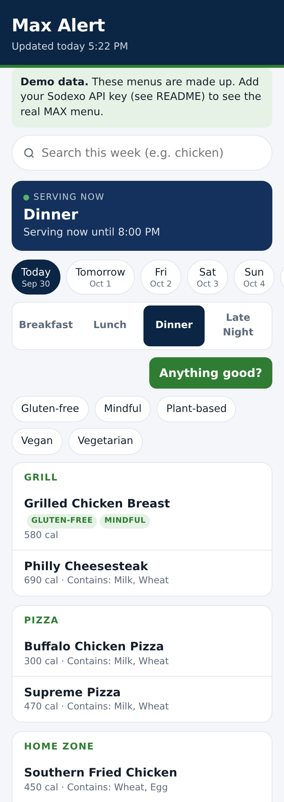

# Max Alert

A mobile-first web app that shows what the GCSU dining hall (The MAX) is serving: now, later today, and all week.



**Features:** current/next meal on the home screen, date picker + meal tabs, location filter (it appears automatically when there's more than one location), dietary badges and filters, week-wide search, and an "Anything good?" button that gets a casual AI summary of today's menu.

**Menu layout:** stations (Grill, Pizza, Deli...) are collapsible sections labeled like "Grill (8)". They start collapsed except the one you opened last, and there's **Expand all / Collapse all**. The **Proteins** button lists protein-focused dishes (chicken, beef, fish, eggs, tofu...) from every station, highest protein first.

**Accounts + Build Your Plate:** the menu never needs a login. Tap **+** on any dish to add it to My Plate (a bottom sheet), adjust servings in half steps, and see running calories/protein/carbs/fat. **Log this meal** saves to your account; if you're logged out it asks you to log in or sign up first. From the profile icon (top right): **My Calories** (today's meals, totals, goal progress, edit/delete), **Settings** (calorie goal) and **Log out**. **Quick add** covers anything not on the menu.

**Stack:** Python Flask backend (fetches + caches the menus) and a plain HTML/CSS/JS frontend (no build step).

---

## Run it locally

You need Python 3.10+.

```bash
cd max-alert
python -m venv .venv
source .venv/bin/activate          # Windows: .venv\Scripts\activate
pip install -r requirements.txt
python app.py
```

Open http://localhost:5000. To try it from your phone, open `http://<your-computer's-IP>:5000` while on the same Wi-Fi.

With no keys set, the app runs in **demo mode**: it shows made-up sample menus and a "Demo data" banner. That lets you see the UI right away.

### Hook up the real GCSU menu (one time)

```bash
pip install playwright && playwright install chromium   # optional but most reliable
python discover.py
```

`discover.py` opens The MAX's page, finds the menu API call, and writes:

- `locations.json`: each location's Sodexo `location_id` and `menu_id`
- `.env`: `SODEXO_API_KEY=...`

Restart `python app.py`. The banner goes away and the real menu loads.

If the script can't find everything, do it by hand (takes about 2 minutes; see "How the data source works" below). Copy `locations.example.json` to `locations.json` and `.env.example` to `.env`, then fill them in.

### Turn on "Anything good?"

Get an API key at https://console.anthropic.com and add it to `.env`:

```
ANTHROPIC_API_KEY=sk-ant-...
ANTHROPIC_MODEL=claude-haiku-4-5
```

Only today's menu is sent, and results are cached, so repeat taps don't cost anything. Without a key, the button shows a friendly "not set up yet" message.

### Get alerted if menus stop updating (recommended)

The app repairs itself when Sodexo rotates its key or starts a new menu (see "If it breaks"). If it can't, it can ping you. Easiest option, free push notifications with no account:

1. Install the **ntfy** app (iOS/Android) and subscribe to a long random topic name, e.g. `max-alert-7f3k29xq`.
2. Add to `.env` (and to your host's environment variables):

```
ALERT_WEBHOOK_URL=https://ntfy.sh/max-alert-7f3k29xq
```

You get a message after 12 hours of failed downloads (`ALERT_AFTER_HOURS`), a reminder each day it lasts, one when it fixed itself, and one when menus are back. Discord and Slack webhook URLs work too. Without a URL, alerts only go to the server log.

### Run the tests

```bash
pip install pytest
python -m pytest -q
```

---

## How the data source works

This is how I figured it out, so you can redo it if Sodexo changes the site.

**1. The page doesn't contain the menu.** `georgiacollege.sodexomyway.com/en-us/locations/the-max` only includes the page shell: the date picker, the allergen filter checkboxes, the address. The menu items are loaded afterward by JavaScript, so HTML scraping would find nothing.

**2. The JavaScript calls a JSON API.** In Chrome DevTools → **Network** tab, reload the page and filter for `sodexomyway.net`. You'll see a request like:

```
GET https://api-prd.sodexomyway.net/v0.2/data/menu/<locationId>/<menuId>?date=2026-09-30
Request header:  Api-Key: <long string>
```

- `<locationId>` is an 8-digit number. GCSU's site ID shows up in the page (the logo's alt text says `54283001`), and location IDs are built from it, so expect something like `5428300X`.
- `<menuId>` is the number for that location's menu (for The MAX in fall 2026, `discover.py` found location `54283001`, menu `1410800`).
- `Api-Key` is a key the Sodexo website gives every visitor's browser. It isn't a personal login.

The same API powers every school on Sodexo's "MyWay" platform. I confirmed the URL format, the key header and the JSON shape against an open-source project for the University of Cincinnati's dining halls, which uses the same system and includes real saved responses. (One of those responses is `tests/fixtures/sample_menu.json`.)

**3. What the JSON looks like** (one location, one day):

```json
[
  { "name": "Lunch",
    "groups": [
      { "name": "Grill",
        "items": [
          { "formalName": "Cheeseburger", "description": "...",
            "isVegan": false, "isVegetarian": false, "isPlantBased": false, "isMindful": false,
            "calories": "540", "protein": "28g", "portion": "1 EA",
            "allergens": [ { "name": "Milk" } ] } ] } ] }
]
```

Meals → `groups` (stations) → `items` (dishes). `sodexo.py` turns this into a simpler shape the frontend uses. The flags become badges (`isVegan` → Vegan, and so on). A "Gluten-free" badge only appears if Sodexo sends a gluten-free flag; the app never guesses. Rows like "Have a Nice Day" (ingredient text "Plate Cost Peripherals") are skipped because they aren't food.

**4. Nutrition.** There's no separate nutrition endpoint to call: every item in the menu response already carries `calories`, `protein`, `carbohydrates`, `fat` and `portion` (serving size), per serving, as text like `"35g"`. This is the same data the Sodexo site's "Nutrition Calculator" uses. `sodexo.py` parses these into `calories`, `protein_g`, `carbs_g`, `fat_g` and `portion`, and they're stored in the cache with each item. A blank field becomes `null`, never `0`, and the app shows **"Nutrition info not available"** for items with no numbers (or "—" for a single missing value). Plate and day totals leave out unknown values and say so.

To see coverage in the real data, run:

```bash
python nutrition_report.py         # per meal: items with full / partial / no nutrition, and which dishes are missing it
python nutrition_report.py --raw   # also lists every field Sodexo sends per item today (to spot new nutrition fields)
```

Which GCSU items are missing nutrition isn't known ahead of time. Nutrition was built and tested against Sodexo's response format and demo data, not GCSU's live feed, so the report above is how you find out. Retail spots (Chick-fil-A, Pizza Hut, Ibasho Sushi, The Mini) didn't show a menu API call in `discover.py`, so they have no menu or nutrition in the app.

**5. Meal times.** The API gives meal *names* but not times. Times live in `MEAL_HOURS` in `config.py`, taken from The MAX's posted Fall 2025 hours. **Update these each semester.** They only decide which meal the home screen shows as "Serving now" / "Up next".

### If it breaks

**Most breakages fix themselves.** When *every* download fails, the app reruns discovery over plain HTTP (at most every 6 hours). It reads the key and API URL from the `Production` entry in the site's JS bundle and the menu ID from the page. If verified new values work, it saves them to `data/sodexo_override.json`, reloads the menus, and sends you an alert. That file is ignored automatically once you change `SODEXO_API_KEY`, `SODEXO_API_URL` or `locations.json` yourself. On hosts that wipe `data/` on redeploy (Render's free plan does), the app just finds the values again, but it's still worth making the fix permanent with `python discover.py`. After 12 hours of failures the site shows a "Menus may be out of date" banner, and `/api/health` reports `"menus_ok": false`.

The table is for when the automatic fix doesn't work:

| Symptom | Likely cause | Fix |
|---|---|---|
| Yellow "couldn't reach the dining site" banner, logs show `401`/`403` | API key rotated, or menu ID changed (Sodexo answers `401` for a bad menu ID too) | Rerun `python discover.py` (or copy the new `Api-Key` from DevTools into `.env`) |
| `404` in logs | Location/menu ID changed | Rerun `discover.py`, or copy the new numbers from the DevTools request URL into `locations.json` |
| Errors about "expected a list of meals" or missing fields | Sodexo changed the JSON shape | Look at the new response in DevTools → Preview, then update `normalize()` in `sodexo.py` |
| URL is no longer `/v0.2/...` | New API version | Set `SODEXO_API_URL` in `.env` to the new pattern (keep `{location_id}` and `{menu_id}`) |
| Wrong meal highlighted as "Serving now" | Hours changed | Edit `MEAL_HOURS` in `config.py` |

When a refresh fails, the app keeps showing the last good menu with its "Updated …" time and retries every 15 minutes.

### Adding more locations

Chick-fil-A, Pizza Hut and the other retail spots usually don't publish daily menus. If one does (you'll see the same API call on its page), run `python discover.py <that page's URL>` or add it to `locations.json`. A location dropdown appears as soon as there are two or more.

---

## How it works

```
Browser ──GET /api/menus──▶ Flask (app.py)
                              │ reads cache (memory + data/menu_cache.json)
                              │ if older than 3h → refresh in background
                              ▼
                         menu_store.py ──▶ sodexo.py ──▶ api-prd.sodexomyway.net
                                           (7 days × each location, 4 at a time, 2 tries each)
Browser ──POST /api/summary──▶ summary.py ──▶ Anthropic API
```

| File | What it does |
|---|---|
| `app.py` | Routes, "current or next meal" logic |
| `menu_store.py` | Caching, background refresh, keeps old data when a fetch fails |
| `sodexo.py` | Calls the Sodexo API and normalizes the JSON |
| `summary.py` | "Anything good?" prompt + Anthropic API call |
| `auth.py` | Sign up / log in / log out (Flask-Login) |
| `tracker.py` | Calorie log API for the logged-in user |
| `models.py` | Database tables: users, logged meals, logged items |
| `logbook.py` | Log validation + saving, and the one-time import of old logs |
| `nutrition_report.py` | Shows how much nutrition data the real menu has |
| `static/account.js` | Log in button, profile menu, log in / sign up dialog, import prompt |
| `static/plate.js` | My Plate sheet, Quick add, My Calories and Settings views |
| `config.py` | Settings, meal hours, location loading |
| `discover.py` | Finds location IDs, menu IDs and the API key |
| `demo_data.py` | Fake menus for demo mode |
| `static/` | Frontend (`index.html`, `app.js`, `style.css`) |

Settings (all optional, in `.env`): `REFRESH_HOURS` (default 3), `DEMO_MODE=1` to force demo data, `PORT`, `ANTHROPIC_MODEL`.

## Accounts and the database

**Setup:** run `pip install -r requirements.txt`. That's it: on first start the app
- creates `SECRET_KEY` in `.env` if it's missing (it signs login cookies; keep it secret, and changing it logs everyone out)
- creates the SQLite database `data/maxalert.db` with the `users`, `logged_meals` and `logged_items` tables

You can also create the tables yourself with `flask --app app init-db`. Starting the app never deletes data. To start over, stop the app and delete `data/maxalert.db`. To use another database (e.g. Postgres when hosting), set `DATABASE_URL` in `.env`.

**Security:**
- Passwords are hashed with werkzeug (scrypt + salt). The plain password is never stored or logged.
- Login sessions are cookies signed with `SECRET_KEY`. "Remember me" lasts 60 days.
- Log in, sign up and log changes only accept JSON requests, so another website can't submit them on your behalf.
- Wrong-password messages don't reveal whether an email has an account.
- After 10 failed logins from one IP in 15 minutes, logins from that IP pause briefly.
- Users can only see and change their own meals.

**Before putting it on the internet:**
- Serve it over HTTPS, set `SECURE_COOKIES=1`, and run it with a real server (e.g. `gunicorn app:app`) instead of `python app.py`.
- There's no password reset yet, since that needs an email service.

**Importing the old log:** before accounts, logs were saved in `data/logs/<log name>.json`, and the browser remembered the log name. The first time someone logs in on that browser, the app offers to copy that log (and goal) into their account. It asks once per account. An imported file is renamed `...imported-by-<id>.json` so it can't be imported twice.

**Log API** (all need a login): `GET /api/log?date=YYYY-MM-DD`, `POST /api/log/meals`, `PUT` or `DELETE /api/log/meals/<id>`, `PUT /api/log/settings` with `{"goal": 2200}`. Auth: `GET /api/auth/me`, `POST /api/auth/signup|login|logout`.

## Be a good neighbor

Sodexo's site is for personal, non-commercial use. The app caches aggressively (about 8 requests per location every 3 hours), identifies itself honestly in its User-Agent, and doesn't pound the server. Keep it that way if you share it with friends. Allergen and nutrition info comes from Sodexo and can be wrong or out of date, so anyone with a serious allergy should confirm with dining staff.
